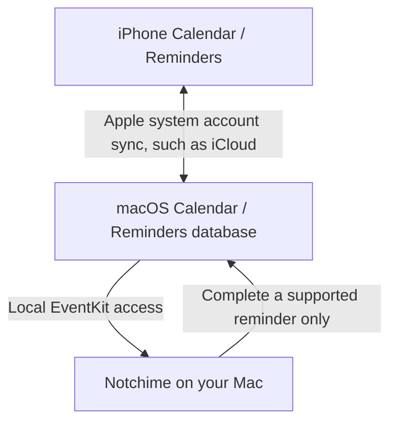
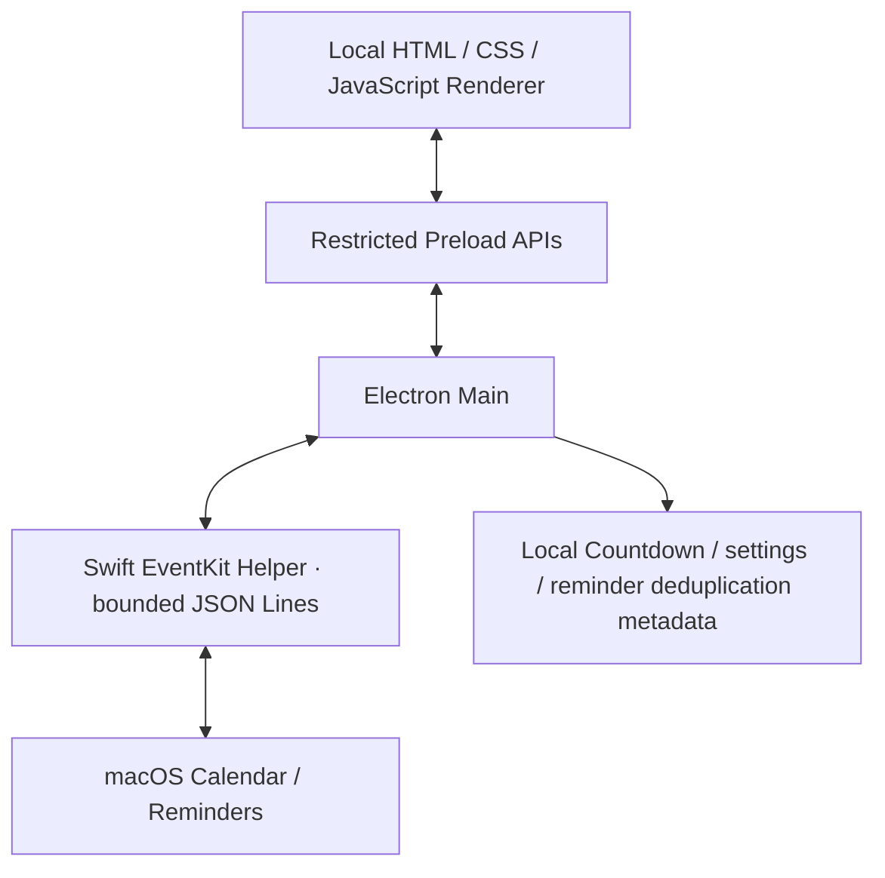

<div align="center">
  
  <h1>Notchime</h1>
  <p><strong>There When You Need It. Quiet When You Don't.</strong></p>
  <p><strong>Your Apple day, right in your MacBook notch.</strong><br />
  A privacy-first macOS notch companion for Apple Calendar, Reminders, and Countdown.</p>
  <p><strong>English</strong> · <a href="README.zh-CN.md">简体中文</a></p>
  
  <p><a href="#your-day-at-a-glance">Explore</a> · <a href="#get-started">Get started</a> · <a href="docs/PRIVACY.md">Privacy</a> · <a href="#faq">FAQ</a></p>
</div>


*Actual development interface with fictional test data. The current app UI is Chinese; this English README does not imply an English interface or a published release.*

## Your day, at a glance

Check your next meeting. Finish a reminder. Keep an important date in view. Notchime brings these small moments together at the top of your Mac, then gets out of the way.

| Calendar | Reminders | Countdown | Smart Notch |
|---|---|---|---|
| Today, what's next, and the next seven days. | Today's and overdue tasks, with a quick completion action. | Important dates, saved on this Mac. | A timely glance, with hover protection and manual control. |

### See it in ten seconds

[](docs/assets/notchime-trailer-10s.mp4)

**[Watch or download the film](docs/assets/notchime-trailer-10s.mp4)** · 9.6 seconds · 1080p · sound

The film uses actual Mac app captures with fictional data and illustrative iPhone/device animation. It is a product presentation, not a recorded iCloud synchronization test. Smart Notch footage is edited for pacing, not a real-time demonstration of its four-second timer. GitHub may open a file page or download the MP4; this README does not rely on inline video autoplay.

## One Apple Ecosystem. One Seamless Workflow.

Plan an event or add a reminder on your iPhone. Once your Apple system account syncs it to the Mac, Notchime reads it locally through EventKit. Complete a supported reminder in Notchime, and Apple handles the onward sync.



**No duplicate entry. No separate task database.**

Notchime does not connect directly to your iPhone or run its own iCloud service. Your accounts, macOS and network conditions determine sync timing; there is no fixed latency guarantee.

## A place for the things that matter

### Apple Calendar — know what's next

See today's schedule, the next ongoing or upcoming timed event, and the next seven days. Choose which calendars to display, keep their system colors, and view all-day, cross-day and recurring event instances.


**Calendar is read-only in Notchime's application behavior.** Create, edit and delete events in Apple Calendar.

### Apple Reminders — clear a little space in your day

Today's due and overdue incomplete reminders appear alongside today's schedule. Click the circle to complete a supported item; Notchime confirms the EventKit write before refreshing the list.


No-due-date and future-due reminders are outside this list. Recurring reminders and items in read-only lists remain visible when due, but must be completed in Apple Reminders. Notchime does not create, edit, delete or reopen reminders, or manage lists.

### Countdown — keep your milestones close

Create, edit, delete and pin local countdowns, with a date, optional time and color. Date-only countdowns follow local calendar days; timed countdowns use the local time zone. Your countdowns persist across restarts, independently of Calendar and Reminders.


**Countdowns stay on this Mac.** They do not sync to iPhone or iCloud. Dates shown in the screenshots are fictional examples, not a release schedule.

### Smart Notch — a glance when it helps

A brief overview appears on startup, wake or unlock. Selected, non-all-day events can bring up a visual reminder **5, 10 or 15 minutes** before their start; the default is 10 minutes, and reminders can be turned off.


Automatic reveals stay open for about **four seconds** by default; Settings allows 1–60 seconds. Hovering pauses the timer, and leaving starts a full interval again. Intentional interaction hands control to you. A manually opened panel is not closed by the automatic timer, and an automatic reveal does not switch away from your Settings or Countdown form.

These are notch visual reminders, without Notification Center messages, sound or Dock bouncing. Wake/unlock behavior has user acceptance on the development machine; macOS 13/14 and the final distributed app still need device validation.

## Your Schedule. Your Data. Your Privacy.

- **No Notchime accounts.** Use the accounts already configured in macOS.
- **No custom sync servers.** Calendar and Reminders synchronization belongs to Apple/system account services.
- **No tracking or analytics in the current application code.**
- **Local-first by design.** Countdown and preferences are saved locally; system events and reminders are not copied into a second task database.
- **Limited application operations.** Calendar reads only; completing a supported reminder is the only reminder write operation.
- **No application feature uploads personal Calendar or Reminders content to a Notchime server.**

On macOS 14+, reading Calendar requires system **Full Access**, and Reminders also uses **Full Access**. Notchime limits what its code does; macOS does not grant it a special “read-only” or “complete-only” permission. Apple account sync, dependency downloads and OS/framework diagnostics are separate from these application claims.

Read the [privacy notice](docs/PRIVACY.md) for data fields, local storage, permission revocation and audit limits. The [security audit](docs/phase5a-privacy-security-audit.md) and [code review](docs/phase5b-final-code-review.md) document evidence and unresolved release checks, rather than promising absolute security.

## Get started

### Available now — run from source

Use a trusted copy of this source project. Open a terminal in its root directory after installing Node.js and Apple's Xcode Command Line Tools, then:

```sh
npm ci
npm start
```

`npm ci` installs the locked development dependencies and downloads Electron. `npm start` runs a prestart script that compiles and **ad-hoc signs the local Swift Helper** when necessary, then launches Electron. It does not install the app into Applications. Inspect the scripts before running them; compilation/signature errors are real failures, not instructions to bypass verification.

In **Settings → Calendar**, request Calendar access and select calendars. In **Today's reminders**, request Reminders access separately. Denying Reminders does not disable Calendar or local Countdown. The current source identity remains **Calendar Notch Dev**; that name may appear in system permission prompts. Source mode does not register the generic Electron app as a login item.

### Planned release — a downloadable macOS app

**There is no validated official Notchime DMG download yet.** Formal app identity, signing/notarization, Electron fuses, ASAR integrity, TCC ownership and clean-install acceptance remain release work. No Homebrew installation or release URL is advertised here.

A local ad-hoc signature is not Developer ID signing or notarization. If a future distribution uses ad-hoc signing, it will need explicit Gatekeeper and verification guidance for that exact build. Do not globally disable Gatekeeper to run this project.

## System requirements

| Item | Current evidence |
|---|---|
| Platform | macOS only; designed around the MacBook notch. |
| Architecture | Apple Silicon / arm64 configured and tested. Intel builds are not provided or verified. |
| Minimum configured target | macOS 13.0+, in the Builder configuration and Swift compilation target. |
| Actually tested environment | Apple Silicon, macOS 27.0; Node 22.22.0, npm 10.9.4, Swift 6.1.2 and Electron 44.0.0. macOS 13/14 device behavior is not verified. |
| Development tools | Node.js **22.12.0+**, npm (no separate minimum is declared), and Xcode Command Line Tools with Swift and the macOS SDK. |
| Displays without a notch | Code positions the panel using display/menu-bar geometry and a fallback height. A physical notch is not a code requirement; final non-notch/external-display acceptance is still pending. |

## Development and architecture

**Electron-powered macOS app with native Swift EventKit integration.** Electron owns the local interface and window lifecycle; EventKit gives the Helper access to the Mac's existing system calendars and reminders, without another sync service.



Calendar writes are absent by design. The only Reminders write is a validated completion request. Countdown storage is separate from system data. See [CONTRIBUTING](CONTRIBUTING.md) for the module map and safe test workflow.

```sh
npm run test:unit
npm test
```

`npm test` runs unit tests, JavaScript syntax checks, isolated Fixture Electron scenarios and source startup without the signing prestart script. The pure Swift date tests compile a test executable in the project's test cache. GUI checks require a usable macOS desktop. These tests do not prove real iCloud sync or final package signing.

<details>
<summary>Packaging commands and their current limitations</summary>

| Script | Actual behavior |
|---|---|
| `npm run native:build` | Compile and ad-hoc sign a changed Helper; verify the new build strictly, or reuse the unchanged cache. |
| `npm run pack` | Build an unpacked app through electron-builder. |
| `npm run build:zip` | Build a macOS ZIP. |
| `npm run build` | Build an arm64 macOS DMG with publishing disabled. |

All packaging scripts first run the Helper build and then the existing afterPack ad-hoc signing hook, including final strict/deep signature verification. Outputs target `dist.noindex`. There is a known strict-signing blocker; these are developer scripts, not a validated installation route. This documentation phase did not run them, sign anything or produce an installer.

</details>

## FAQ

**Does Notchime require an account?**  
No Notchime account. Your existing Apple/system account is what syncs Calendar and Reminders.

**Does it upload my Calendar or Reminders?**  
The current application has no feature for uploading personal event or task content to a Notchime server. Apple/system synchronization and OS diagnostics have their own behavior; see [Privacy](docs/PRIVACY.md).

**Does it sync directly with my iPhone?**  
No. Apple system accounts sync to the Mac; Notchime then reads the local EventKit store. Completion changes follow the same system sync path back.

**Can I edit Calendar events or complete every reminder?**  
Calendar is read-only. Only current, due/overdue, non-recurring reminders in writable lists can be completed. Use Apple Reminders for recurring or read-only items and for other task management.

**Do Countdowns sync across devices?**  
No. They are independent local records on this Mac.

**Does it support Windows, Linux or Intel Macs?**  
Windows/Linux are out of scope. Intel has no verified build or acceptance coverage.

**Is it a fully native Swift application?**  
No. The app uses Electron with a native Swift EventKit Helper.

**What permissions are required?**  
Separate Calendar and Reminders access, only when you choose to grant them. On macOS 14+ these are Full Access; the application's operations remain limited. Camera, microphone, screen-recording and accessibility access are not requested for the current core features.

**Why is there no official DMG yet?**  
Final identity, signing, packaging security and clean-install validation have not been completed. The source and audited development behavior should not be mistaken for a released installer.

## Contributing and security

Bug reports and focused improvements are welcome. See [CONTRIBUTING.md](CONTRIBUTING.md); use fictional or redacted data in any report. Do not publish account addresses, private schedules or reminder lists.

Report vulnerabilities privately to **[tianyu.gaospk@gmail.com](mailto:tianyu.gaospk@gmail.com)**. See [SECURITY.md](SECURITY.md). No guaranteed response SLA or encrypted email channel is implied.

## License and acknowledgments

Maintained by **GAO TIANYU** · [GitHub](https://github.com/GAO9228TIANYU) · [Contact](mailto:tianyu.gaospk@gmail.com).

Notchime evolved from [TO-DO Panel v1.2.0](https://github.com/xiaopu-ai/TO-DO-Panel/tree/v1.2.0), by xiaopu-ai and contributors. The original MIT copyright, permission and disclaimer remain in [LICENSE](LICENSE); see [NOTICE](NOTICE) and [third-party attribution](THIRD_PARTY_NOTICES.md). Third-party code and artwork retain their respective rights. The supplied icon's public redistribution rights still require maintainer confirmation before publication; the source MIT license does not automatically relicense media.

Apple, iPhone, MacBook, Calendar and Reminders are referenced to describe compatibility, without implying Apple sponsorship or endorsement.
