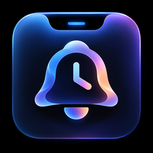
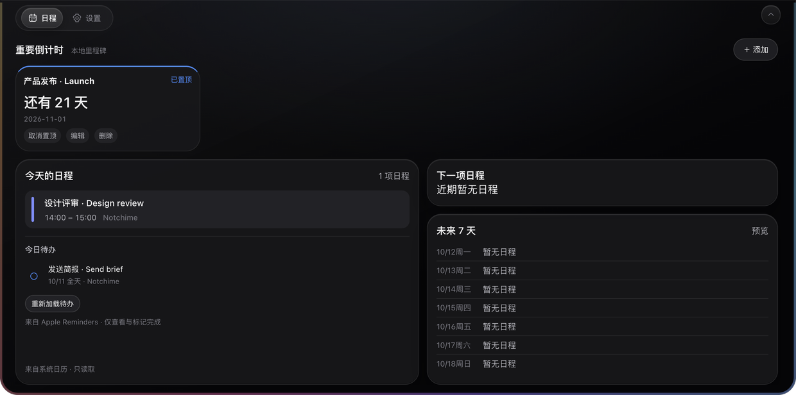
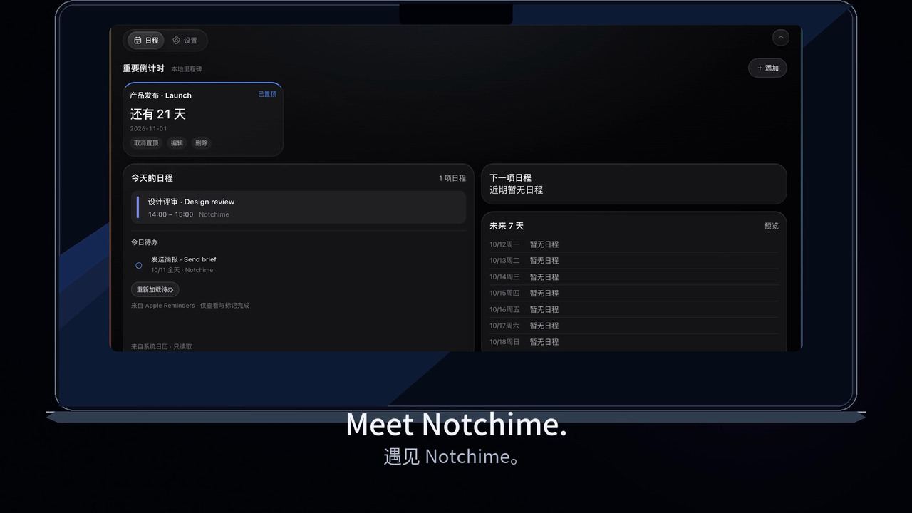
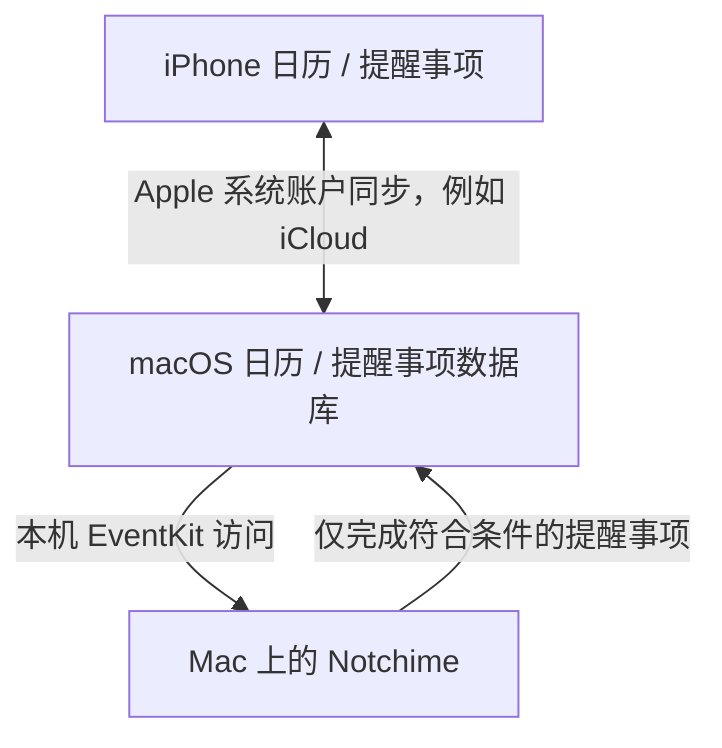
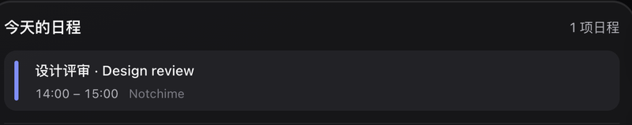
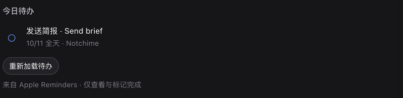
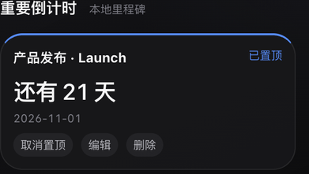
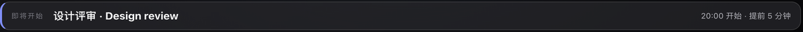
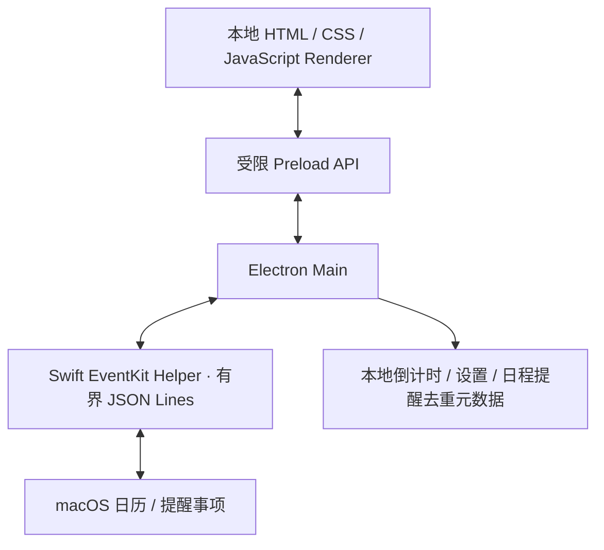

<div align="center">
  
  <h1>Notchime</h1>
  <p><strong>需要时出现，无需时静默。</strong></p>
  <p><strong>把 Apple 生态中的一天，带到 MacBook 的刘海里。</strong><br />
  一款隐私优先的 macOS 刘海助手，汇集 Apple Calendar、Reminders 与本地倒计时。</p>
  <p><a href="README.md">English</a> · <strong>简体中文</strong></p>
  
  <p><a href="#一眼看清今天">了解功能</a> · <a href="#开始使用">下载与安装</a> · <a href="docs/PRIVACY.md#简体中文">隐私说明</a> · <a href="#常见问题">常见问题</a></p>
</div>



*截图来自实际开发界面，内容全部为虚构测试数据。当前应用界面为中文；双语文档不代表应用已提供英文界面，也不代表已正式发布。*

## 一眼看清今天

看一眼下一场会议，完成一条待办，让重要的日期始终在心里有数。Notchime 把这些小事放在屏幕顶部，方便查看，也懂得适时收起。

| 日历 | 提醒事项 | 倒计时 | Smart Notch |
|---|---|---|---|
| 今天、下一项与未来七天日程。 | 今日及逾期待办，一次点击完成符合条件的事项。 | 重要日期，保存在这台 Mac。 | 适时展开、悬停保护，手动操作由你掌控。 |

### 用十秒认识 Notchime

[](docs/assets/notchime-trailer-10s.mp4)

**[观看或下载短片](docs/assets/notchime-trailer-10s.mp4)** · 9.6 秒 · 1080p · 有声

短片使用虚构数据的真实 Mac 应用画面，以及 iPhone 和设备框架的示意动画。它是产品展示，不是 iCloud 同步实录。Smart Notch 镜头经过节奏剪辑，不能据此判断真实四秒计时。GitHub 可能打开文件页或下载 MP4，本页不依赖内嵌视频自动播放。

## 融入 Apple 生态，让日程自然流转。

在 iPhone 上安排日程或添加待办。Apple 系统账户将内容同步到 Mac 后，Notchime 通过本机 EventKit 读取。你在 Notchime 中完成符合条件的待办后，后续同步仍由 Apple 系统处理。



**无需重复录入，也无需维护第二套待办数据库。**

Notchime 不直接连接 iPhone，也没有自建 iCloud 同步服务。同步速度由账户服务、macOS 和网络状况共同决定，不能保证固定延迟。

## 给重要的事，留一个位置

### Apple Calendar：知道接下来要做什么

查看今天的日程、正在进行或即将开始的下一项定时日程，以及未来七天。选择要展示的日历，保留系统日历颜色，并正确呈现全天、跨天和重复日程实例。



**Notchime 的日历操作始终只读。** 创建、编辑和删除日程，请在 Apple Calendar 中进行。

### Apple Reminders：顺手完成今天的小事

今天到期和已经逾期的未完成事项，与今日日程放在一起。点击左侧圆圈即可完成符合条件的事项；确认 EventKit 写入后，列表才会刷新。



没有截止日期、未来才到期的事项不在当前列表中。重复提醒事项和只读清单中的事项到期时可以显示，但需要在 Apple Reminders 中完成。Notchime 不创建、编辑、删除或恢复未完成事项，也不管理清单。

### Countdown：让重要时刻更近一点

创建、编辑、删除和置顶本地倒计时，设置日期、可选时间与颜色。仅指定日期时按本地自然日计算；指定时间时使用本地时区。重启后仍会保留，与系统日历及提醒事项相互独立。



**倒计时只保存在这台 Mac，不同步到 iPhone 或 iCloud。** 截图中的日期仅为示例，不是产品发布计划。

### Smart Notch：需要时，才多看一眼

启动、唤醒或解锁后，短暂展开今日概览。选中日历中的非全天日程，可在开始前 **5、10 或 15 分钟**展开刘海视觉提醒；默认提前 10 分钟，也可以关闭。



自动展开默认停留约 **4 秒**，可在设置中调整为 1–60 秒。鼠标悬停暂停计时，移开后重新计满；主动操作则交还控制权。手动打开的面板不会被自动计时器收起，自动展示也不会强行切走你正在使用的设置页或倒计时表单。

这是刘海视觉提醒，不发通知中心通知、不播放声音，也不让 Dock 图标跳动。开发机上的唤醒与解锁行为已由用户验收；macOS 13/14 和最终分发版本仍需真机验证。

## 你的日程，你的数据，你的隐私。

- **无需 Notchime 账户。** 使用 macOS 已配置的系统账户即可。
- **没有自建同步服务器。** 日历与提醒事项同步交由 Apple 或系统账户服务处理。
- **当前应用代码没有用户追踪或分析功能。**
- **本地优先。** 倒计时和偏好保存在本机，不另建系统日程或待办副本数据库。
- **应用操作受限。** 日历只读，提醒事项唯一支持的写入是完成符合条件的事项。
- **没有把个人日历或提醒事项内容上传到 Notchime 服务器的应用功能。**

macOS 14+ 中，读取 Calendar 需要系统 **Full Access（完整访问）**，Reminders 同样使用完整访问。Notchime 通过代码限制实际操作，系统并未提供专门的“只读”或“仅完成”授权。Apple 账户同步、依赖下载和操作系统／框架诊断不包含在上述应用行为承诺中。

[隐私说明](docs/PRIVACY.md#简体中文)介绍访问字段、本地存储、撤销权限与审计边界。[安全审计](docs/phase5a-privacy-security-audit.md)和[代码审查](docs/phase5b-final-code-review.md)提供证据与待完成的发布检查，不承诺绝对安全。

## 开始使用

### 下载 Notchime 1.0.0 测试候选版

**[下载 Apple Silicon DMG 安装包（Google Drive）](https://drive.google.com/file/d/1JIidJ8UssXWtGOK3YWHOgUAH_S-Ndok2/view?usp=sharing)**

文件：**`Notchime-1.0.0-arm64.dmg`** · 约 **125 MB** · **macOS 13+、Apple Silicon 芯片**。macOS 13/14 真机兼容性尚未验证；此安装包不适用于 Intel Mac。

当前提供的是 **ad-hoc 签名的测试 RC**，尚未使用 Developer ID 签名或通过 Apple 公证。本地包已通过隔离启动和主要功能检查，但 Gatekeeper 检查结果为拒绝；通过互联网下载及 Applications 安装仍需验收。实际验证范围见 [RC 报告](docs/release/notchime-v1.0.0-release-report.md)。

### 安装与首次启动

1. 打开上方 Google Drive 链接，点击页面中的 **下载**，保存 DMG。使用安装包不需要安装 Node.js 或 Xcode。
2. 双击 DMG，将 **Notchime.app** 拖到窗口内的 **Applications（应用程序）** 图标。如果已有同名应用，先备份，再决定是否替换。
3. 在 **应用程序 → Notchime** 中启动。应用会出现在屏幕顶部，点击顶部横栏展开；通常不会显示 Dock 图标。
4. 若 macOS 提示“无法验证开发者”或“Apple 无法检查是否包含恶意软件”，仅在确认来源可信、文件核对无误后继续：先尝试打开，再到 **系统设置 → 隐私与安全性 → 仍要打开**，并在提示中确认 **打开**（仅当系统提供此入口时）。这是针对该应用的例外，不代表 Apple 公证，详见 [Apple 官方说明](https://support.apple.com/en-us/102445)。不要关闭 Gatekeeper，也不要用终端移除隔离属性。若提示应用已损坏或会损害电脑，请停止并反馈。
5. 安装后的应用启动成功后，推出 DMG。需要开机启动时，在安装到应用程序目录后，进入 Notchime **设置**，勾选 **开机自动启动**。

<details>
<summary>核对下载文件（可选）</summary>

此前已验收的本地 RC 的 SHA-256 如下。本次文档修改未重新下载 Google Drive 副本进行独立校验：

```text
aed32944bd98885fbf5a779f9a51d0c75558e729ae91eb49c5b9958a8715579a
```

在终端输入 `shasum -a 256`，后接下载的 DMG 路径即可核对。相同哈希表示文件字节与本地测试包一致，不代表通过 Apple 公证。若不一致，先核实来源与版本，不要继续运行。

</details>

### 授予日历与提醒事项权限

两项权限需要分别在应用内主动申请：

1. **日历：** 点击顶部横栏展开 → **设置 → 日历 → 允许读取日历**。在 macOS 系统弹窗中亲自确认允许，再勾选希望展示的日历。
2. **提醒事项：** 打开 **日程** 页面，在 **今天的日程 → 今日待办** 中点击 **允许访问提醒事项**，亲自确认另一项系统授权。授权后显示今天到期及已逾期的未完成事项，不显示未来到期或没有截止日期的事项。
3. **没有弹窗或此前点过拒绝：** 到 **系统设置 → 隐私与安全性 → 日历／提醒事项**，分别检查并启用 **Notchime** 的访问权限。返回应用，点击 **重新加载** 或 **重新加载待办**。已经授权时，系统可能不会再次弹窗；受单位或学校管理的 Mac 需联系管理员，不要重置权限数据库。

macOS 14+ 的两项系统授权均为 **完整访问（Full Access）**。Notchime 进一步限制实际行为：日历只读取、不创建修改或删除；提醒事项只在你主动点击时完成当前有效、非重复且位于可写清单的事项。拒绝任一授权仍可使用本地倒计时，拒绝提醒事项不会禁用日历；无需摄像头、麦克风或录屏权限。

正式身份为 `com.notchime.app`，使用独立 Notchime 数据目录；旧开发版权限和数据不会自动迁移或删除。倒计时仅保存在本机。iPhone 与 Mac 的同步由 Apple 系统账户负责；内容未出现时，先确认 Mac 自带的日历或提醒事项中已经能看到，无法承诺固定同步时间。

### 另一种方式：从源码运行

准备好 Node.js 和 Apple Xcode Command Line Tools 后，在可信项目源码的根目录打开终端：

```sh
npm ci
npm start
```

`npm ci` 安装锁定开发依赖并下载 Electron。`npm start` 会在需要时先编译并 **ad-hoc 签名本地 Swift Helper**，再启动 Electron；不会将应用安装到 Applications。运行前检查脚本，编译或签名失败需解决，不能绕过校验。源码模式不会把通用 Electron 登记为登录项。

## 系统要求

| 项目 | 当前证据 |
|---|---|
| 平台 | 仅 macOS，围绕 MacBook 刘海设计。 |
| 架构 | 已配置并测试 Apple Silicon / arm64；未提供或验证 Intel 构建。 |
| 配置最低版本 | Electron Builder 与 Swift 编译目标均为 macOS 13.0+。 |
| 实际测试环境 | Apple Silicon、macOS 27.0；Node 22.22.0、npm 10.9.4、Swift 6.1.2、Electron 44.0.0。macOS 13/14 真机行为尚未验证。 |
| 开发工具 | Node.js **22.12.0+**、npm（项目未另行声明最低版本），以及带 Swift 和 macOS SDK 的 Xcode Command Line Tools。 |
| 无刘海显示器 | 代码根据显示器及菜单栏几何定位，并提供高度回退，不把物理刘海作为代码前提；最终无刘海／外接显示器验收仍待完成。 |

## 开发与架构

**Electron 驱动的 macOS 应用，配合原生 Swift EventKit 集成。** Electron 负责本地界面和窗口生命周期；EventKit 让 Helper 访问 Mac 已有的系统日历和提醒事项，无需另建同步服务。



日历没有写入接口；提醒事项只接受校验后的完成请求；倒计时与系统数据分开存储。模块及安全测试流程见[贡献指南](CONTRIBUTING.md#简体中文)。

```sh
npm run test:unit
npm test
```

`npm test` 执行单元测试、JavaScript 语法检查、隔离 Fixture Electron 场景及跳过签名 prestart 的源码启动验证。Swift 纯日期测试会在项目测试缓存中编译测试程序。GUI 检查需要可用的 macOS 桌面；这些测试不能证明真实 iCloud 同步或最终包签名成功。

<details>
<summary>打包命令及当前限制</summary>

| 脚本 | 实际行为 |
|---|---|
| `npm run native:build` | 编译并 ad-hoc 签名有变化的 Helper，严格验证新构建；无变化时复用缓存。 |
| `npm run pack` | 通过 electron-builder 生成未封装的应用目录。 |
| `npm run build:zip` | 构建 macOS ZIP。 |
| `npm run build` | 构建 arm64 macOS DMG，禁止发布。 |

打包脚本均先执行 Helper 构建，再运行已有的 afterPack ad-hoc 签名钩子及最终 strict/deep 校验。输出目录为 `dist.noindex`。Desktop 输出可能被 File Provider 重新附加 Finder 元数据；RC 使用项目内 APFS 构建卷，严格校验继续生效。Developer ID／公证和最终安装人工验收仍是独立发布条件。

</details>

## 常见问题

**需要注册账户吗？**  
无需 Notchime 账户。日历和提醒事项同步使用已有的 Apple／系统账户。

**会上传我的日历或待办吗？**  
当前应用没有将个人日程或待办内容上传到 Notchime 服务器的功能。Apple／系统账户同步及操作系统诊断有各自的行为，详见[隐私说明](docs/PRIVACY.md#简体中文)。

**直接连接 iPhone 同步吗？**  
不会。系统账户先同步到 Mac，Notchime 再读取本机 EventKit；完成状态沿同一系统同步路径回传。

**能编辑日历或完成所有提醒事项吗？**  
日历只读。只能完成当前有效、今日到期或逾期、非重复且位于可写清单中的未完成事项。重复／只读事项和其他管理操作请使用 Apple Reminders。

**倒计时会跨设备同步吗？**  
不会，倒计时是这台 Mac 上独立的本地记录。

**支持 Windows、Linux 或 Intel Mac 吗？**  
Windows／Linux 不在支持范围内；Intel 尚无验证过的构建和验收证据。

**是完全原生的 Swift 应用吗？**  
不是，主应用使用 Electron，系统集成使用原生 Swift EventKit Helper。

**需要哪些权限？**  
由你分别主动授予 Calendar 和 Reminders 权限。macOS 14+ 使用完整访问，应用实际操作仍受限制。当前核心功能不请求摄像头、麦克风、录屏或辅助功能权限。

**下载的 DMG 已经是 Apple 公证的正式版吗？**  
不是。上方链接提供 1.0.0 ad-hoc 签名测试 RC；Developer ID、Apple 公证、图标公开再分发权和最终安装／设备验收仍是发布前条件，详见 [RC 报告](docs/release/notchime-v1.0.0-release-report.md)。

## 贡献与安全报告

欢迎报告问题或提交聚焦的改进，具体见[贡献指南](CONTRIBUTING.md#简体中文)。请使用虚构或脱敏数据，不公开账户地址、私人日程或提醒事项清单。

安全漏洞请私下发送至 **[tianyu.gaospk@gmail.com](mailto:tianyu.gaospk@gmail.com)**，流程见 [SECURITY.md](SECURITY.md#简体中文)。不承诺固定响应时限，也不将普通邮箱称为加密渠道。

## 许可证与致谢

当前开发与维护：**GAO TIANYU** · [GitHub](https://github.com/GAO9228TIANYU) · [联系](mailto:tianyu.gaospk@gmail.com)。

Notchime 基于 xiaopu-ai 及贡献者的 [TO-DO Panel v1.2.0](https://github.com/xiaopu-ai/TO-DO-Panel/tree/v1.2.0) 演进而来。原 MIT 版权、许可和免责条款保留在 [LICENSE](LICENSE)；归属信息见 [NOTICE](NOTICE) 与[第三方说明](THIRD_PARTY_NOTICES.md)。第三方代码及图片仍遵循各自权利。当前指定图标的公开再分发权需在发布前由维护者确认，源码 MIT 许可不自动重新授权媒体资源。

Apple、iPhone、MacBook、Calendar 和 Reminders 名称仅用于说明兼容性，不表示获得 Apple 赞助或认证。
