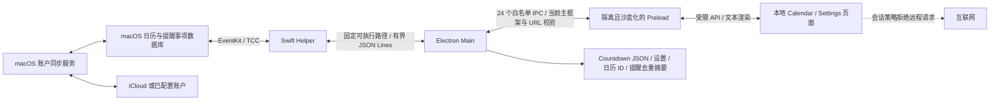

# Notchime v1.0 — Phase 5A 隐私与安全审计

审计日期：2026-10-11。实际源码身份仍为 **Calendar Notch Dev 1.2.0 / com.calendarnotch.dev**，本次未重命名、迁移数据或修改 Bundle ID。

结论：已修复可在本轮安全处理的 IPC、协议校验、日志和浏览器边界问题，补丁未改变窗口动画或产品数据格式。没有确认可从当前产品界面利用的 Critical / High 漏洞；**依赖数据库现为 High 0，但受控测试仍复现了构建缓存组件的敏感响应复用行为，正式发布验收尚未通过**。严格签名问题与生产二进制加固也未验证，不能据此报告批准正式 DMG 分发。

本报告中的 Verified 是对明确审计范围和当前版本的证据结论，不是“所有代码路径绝对安全”的保证。

## 1. 范围、环境与实际检查文件

实际环境：Apple Silicon、macOS 27.0 (26A428)、主测试 Node 22.22.0、Electron 44.0.0 / Chromium 152.0.7977.54 / 内置 Node 24.18.1，Swift 6.1.2。Helper 编译目标为 arm64-apple-macosx13.0；构建配置最低 macOS 13。macOS 13/14 真机未在本轮测试。

| 范围 | 实际阅读、检索或验证的文件 |
| --- | --- |
| 主进程及安全边界 | main.js、main-services.js、preload.js、calendar-ipc.js、reminders-ipc.js、countdown-ipc.js |
| 系统数据与调度 | calendar-bridge.js、calendar-provider.js、reminders-provider.js、automatic-reveal.js、calendar-reminders.js、calendar-settings.js、countdown-store.js |
| 页面与输入 | renderer/index.html、app.js、calendar-model.js、reminders-model.js、reminders.js、panel-interaction.js、countdown-model.js、countdown.js、countdown-picker.js；styles.css、calendar.css、countdown.css |
| 原生 | native/calendar-helper/main.swift、ReminderDate.swift、Info.plist；本机 SDK 的 EKEventStore.h 授权声明 |
| 供应链及构建 | package.json、package-lock.json、实际已安装依赖清单与生命周期脚本；build/afterPack.js、entitlements.mac.plist；scripts/build-calendar-helper.js、release-policy.js、test-desktop.js、smoke-app.js；.github/workflows/release-dmg.yml |
| 测试 | 全部 tests/*.test.js、活动 Electron 测试、tests/fixtures 下的模拟 Helper 与数据、窗口样式基线 |
| 文档与历史资源 | README.md、AGENTS.md、旧发布说明及历史资料目录的引用关系；打包文件白名单与图标引用；隐藏 .claude/settings.json、hooks 两个脚本、rules、settings.local.json.example、.gitignore |

未访问原版 Dynamic Panel 数据，也未检查真实 userData 的内容；未读取真实事件/待办标题、备注作为审计证据。测试只写入项目 .cache/tests 和 .cache/phase5a；未执行 Git、安装全局软件、打包、签名、公证、发布。原生仅做类型检查、既有 Helper 授权状态查询，未请求 snapshot 或任何真实完成操作。

现有 AGENTS.md 中“Mock / 尚未自动展开”等描述已落后于当前代码；本轮以实际源码和用户当前限制为准。

## 2. 数据流与信任边界

系统账户同步由 macOS 完成；应用不提供云账户或网络同步客户端。Calendar 与 Reminders 快照在 Main/Helper/Renderer 内存中流转。Reminder 的 revision 能力令牌仅在 Main 与 Helper 中保留，Renderer 只传当前 ID。Calendar 原生事件身份字段保留以供日程提醒去重；事件备注、位置、URL、参加者不在 DTO 中。

可信边界不是只靠 UI：主进程校验所有活动 IPC 的 owner、当前 mainFrame、精确的本地 index.html URL。原生端再检查授权、身份、修订和允许的唯一写入。任意本地代码执行、已被攻破的 Main、操作系统权限机制失效不在“Renderer 无 Node 权限”的保护范围内。

## 3. 网络行为审计

活动主进程、Preload、Renderer、Swift 中未发现 fetch、XHR、WebSocket、EventSource、axios、远程 SDK、分析、自动更新、HTTP 服务或远程资源初始化入口。所有活动脚本和样式引用都解析为项目内文件；无远程字体、图片或 iframe。历史 Markdown 中的 URL、XML plist 的 DOCTYPE URL 都不等于运行时 HTTP 请求。

| 类别 | 证据及触发条件 | 结果 |
| --- | --- | --- |
| 产品核心 | 本地 HTML + stdin/stdout EventKit Helper；Main 没有网络客户端或服务器启动代码 | 静态检查未发现个人数据上传路径 |
| 系统设置链接 | Main 中两条固定 x-apple.systempreferences 链接，只由白名单接口打开，Renderer 不能传 URL | 用户主动打开本机 Calendar/Reminders 隐私设置；不打开互联网网页 |
| 浏览器会话 | [main-services.js:9](</Users/gaotianyu/Desktop/PMI Lab/求职项目/TO-DO-Panel-main/main-services.js:9>) 拒绝 HTTP/HTTPS/WS/WSS/FTP，保留本地资源；本地 CSP connect-src none | 防止浏览器层意外出站；不干预原生 EventKit/TCC |
| 测试 CDP | smoke-app.js 的 127.0.0.1 HTTP/WebSocket，仅测试诊断；默认 Fixture 模式 | 非生产服务器；不传真实事件内容 |
| 依赖安装与审计 | npm registry 包元数据、安全审计、下载已有依赖补丁；首次 Electron 运行时下载属于开发准备 | 本轮联网仅供应链/官方文档查询，不传日程或任务内容 |
| Builder 版本查询 | electron-builder/out/cli/cli-util.js:10 → simple-update-notifier 的 registry.npmjs.org dist-tags 查询 | 构建时的非必要联网已由 build/build:zip/pack 的 NO_UPDATE_NOTIFIER=1 关闭并测试 |
| 操作系统同步 | EKEventStore 读取系统数据库，不实现云协议 | iCloud 等流量由系统负责，本轮未抓取系统同步请求 |

运行时证据：`.cache/phase5a/runtime-security.json` 只记录协议、域名、模块/资源类型、时间和阻止结果。受控 `net.request` 指向保留测试域名 audit.invalid，结果 ERR_BLOCKED_BY_CLIENT；正常 Fixture 流程没有观察到其他经过该拦截器的远程请求。没有记录正文、查询串、任务 ID 或凭据。

**限制：**这不是全机网络抓包，也没有覆盖 Chromium 启动前内部行为、系统服务和未来新增 Main 网络代码。会话拦截不会拦截 Node 原生 http/https 或 Swift 自行联网；当前源码未发现这些产品路径。不能把“未观察到”扩写为所有路径永远不会联网。

## 4. Electron 安全配置

[main.js:355](</Users/gaotianyu/Desktop/PMI Lab/求职项目/TO-DO-Panel-main/main.js:355>)：contextIsolation:true、nodeIntegration:false、sandbox:true；未关闭 webSecurity，未开启 insecure content、实验性 Blink 特性或 webview。真实 Electron 测试证实 Renderer 的 require/process 不可用。

本轮添加：打包窗口 devTools:false（源码开发仍允许诊断）；会话权限 check/request handler 一律拒绝 Chromium 摄像头、麦克风、地理位置、通知等权限。Calendar/Reminders 权限在原生 Helper 申请，不经过 Chromium handler。实际 geolocation 状态为 denied，未尝试弹出摄像头等真实系统权限。

[main-services.js:17](</Users/gaotianyu/Desktop/PMI Lab/求职项目/TO-DO-Panel-main/main-services.js:17>)：window.open deny；禁止其他页面导航、重定向、子框架导航和 webview 附着，允许当前本地页面正常恢复重载。真实 GUI 中远程跳转没有离开 index.html，也没有创建子窗口。

[renderer/index.html:5](</Users/gaotianyu/Desktop/PMI Lab/求职项目/TO-DO-Panel-main/renderer/index.html:5>)：script-src self，connect-src none，object/frame/base/form 均 none；没有 inline JavaScript 或 eval。style-src unsafe-inline 保留，因为布局变量、日历颜色和动画由 style 属性更新；没有为形式上的 CSP 严格性破坏现有动画。img 只允许 self/data，media 只允许 self/blob，且浏览器媒体权限被拒绝。

仍使用 file://；本轮未切换自定义协议。没有确认当前标题渲染存在 XSS，但 file:// 的本地来源范围、生产 Electron fuses 和二进制完整性仍需最终包验收。加固原则参考 [Electron 官方安全指南](https://www.electronjs.org/docs/latest/tutorial/security)。

## 5. IPC 与 Preload

[preload.js:8](</Users/gaotianyu/Desktop/PMI Lab/求职项目/TO-DO-Panel-main/preload.js:8>) 只通过 contextBridge 暴露受限函数；没有原始 ipcRenderer、通用 invoke/channel、fs、进程或 shell API。订阅函数不把 Electron event 对象转交 Renderer。

| IPC 组 | 数量 | 操作及限制 |
| --- | --- | --- |
| 窗口 | 6 | set-mode、begin-collapse、metrics、set-tab、renderer-ready、report-state；模式/Tab/状态受约束，后两者不提供自动系统任务创建能力 |
| 设置与关于 | 5 | get、auto-collapse seconds、reminder minutes、auto-launch、about；秒数 1–60，提醒只能 0/5/10/15，登录项参数为布尔值；关于内容是固定本地文本 |
| Countdown | 5 | list/create/update/delete/pin；拒绝多余 wrapper/input 字段，模型继续校验日期、时间、名称、颜色、ID；不能传文件路径 |
| Calendar | 4 | refresh/request-access/select/open-settings；没有 create/edit/delete；ID 数量、长度、控制字符、当前可用日历校验 |
| Reminders | 4 | refresh/request-access/complete/open-settings；只有完成写入，ID 为有界字符串，不接受对象、路径或其他修改字段 |

**总计 24 个，全部与 Preload 的活动 invoke 一致。** [main-services.js:5](</Users/gaotianyu/Desktop/PMI Lab/求职项目/TO-DO-Panel-main/main-services.js:5>) 为所有组统一验证发送者及精确 URL；旧业务 IPC 不存在。

真实攻击测试用打包白名单之外的专门 test preload：另一个 BrowserWindow 对全部 24 个 handler 的请求都被拒绝；不存在的 Calendar/Reminder 写入或任意 exec channel 返回 No handler registered。这些拒绝会在测试 stderr 中产生预期日志，不是未捕获的产品异常。

完成按钮只有用户交互监听，不受日程调度器调用。Main 只接受当前内存快照中的可完成 ID，并使用私有 revision；无“按标题猜另一条任务”。这不是系统提供的“仅完成权限”，也不是对物理点击的密码学证明：如果可信 Renderer/Main 本身被攻破，应按应用权限被攻破处理。因此 CSP、文本渲染、frame 校验和最终二进制加固同样重要。

## 6. Swift Helper 与协议

[calendar-bridge.js:8](</Users/gaotianyu/Desktop/PMI Lab/求职项目/TO-DO-Panel-main/calendar-bridge.js:8>) 根据开发/打包路径定位固定 Helper；spawn 参数为空、shell:false，不拼接用户命令。生命周期由 Main 管理，退出时 close/kill 并拒绝等待中的请求，Helper 退出、超时不导致 Main 崩溃；只做有界读取恢复，不自动重试写入。

本轮新增/复查限制：

- requestId UUID、只允许 7 种应用操作；单个请求上限 1 MiB、等待请求上限 64、超时范围 1–120000 ms。
- stdout 累积上限 16 MiB；畸形 JSON、非对象、非法错误结构安全失败并关闭 Helper；未知或迟到 ID 不能匹配其他请求。
- stdin 同步写入失败清理计时器和 pending；stderr 内容及原生错误自由文本不再透传，只发通用诊断/保留受限错误码。
- Swift stdin 自身有 1 MiB 上限，requestId 最多 80 字符；只通过 switch 接受协议操作，没有外部 shell、AppleScript 或网络服务。
- Calendar 查询最多 9×86400 秒，生产 Provider 只查询今天与未来 7 天；所选日历最多 1000。Main 对 calendar/event DTO 作字段投影、类型、长度、日期、颜色、重复身份、数组大小校验（1000 日历、20000 实例），非授权状态完全清空快照。
- SDK EventStore 只有一个 EKEventStoreChanged 观察者，时钟、时区、自然日变化复用刷新；没有新增监听器或网络轮询。

[calendar-provider.js:38](</Users/gaotianyu/Desktop/PMI Lab/求职项目/TO-DO-Panel-main/calendar-provider.js:38>) 不再直接扩展未知 Helper 对象给 Renderer。授权在不同查询之间被撤销时清空快照；刷新失败也不显示 Fixture。系统通知传播和已经展示的内存数据并非瞬时同步，本轮不承诺 TCC 撤销后零毫秒清除所有进程内副本。

Swift 源码本轮未改动。macOS 13 目标类型检查通过，只有旧 Swift driver 弃用警告。本机既有 Helper 的 status 与 remindersStatus 返回 authorized；**未读取真实事件/任务快照、未在本轮重验写入及 iCloud 全链路**。之前用户验收属于历史人工证据，不能伪装成此次自动验证。

## 7. Calendar / Reminders 的权限与写入边界

本机 SDK EKEventStore.h:84/86/88/90 确认：macOS 14+ 提供 Events Full Access / Write Only、Reminders Full Access；没有供本项目读取使用的 Events Read Only 申请接口。13 分支使用 requestAccess(to:)；类型检查验证 availability 分支，13 真机行为 Not Verified。

[Swift main.swift:112](</Users/gaotianyu/Desktop/PMI Lab/求职项目/TO-DO-Panel-main/native/calendar-helper/main.swift:112>) 请求 Events Full Access；实际执行只有 calendars、bounded predicate 和 events 查询，**没有事件 save/remove/create 路径**。Full Access 是系统授权级别，应用代码只读。

[Swift main.swift:159](</Users/gaotianyu/Desktop/PMI Lab/求职项目/TO-DO-Panel-main/native/calendar-helper/main.swift:159>) 请求 Reminders Full Access。完成路径（163–181）重新查授权及 EKReminder，检查当前 ID、hasChanges/refresh、修订 token、5 分钟有效能力、未完成、当前有效截止日期、非重复和可写清单。消耗能力后，唯一显式属性赋值为 `reminder.isCompleted = true`，然后 save(reminder,commit:true)。系统自动设置 completionDate 属于 EventKit 完成语义，不是应用编辑其他属性。失败 reset/清除能力，不报假成功。

重复提醒事项和只读清单 **拒绝完成**，由用户在 Apple Reminders 操作；无创建、编辑、删除、恢复未完成、清单管理接口。系统任务内容未持久化。

[Apple Events 授权 API](https://developer.apple.com/documentation/eventkit/ekeventstore/requestfullaccesstoevents(completion:))、[Apple Reminders 授权 API](https://developer.apple.com/documentation/eventkit/ekeventstore/requestfullaccesstoreminders(completion:)) 可作 API 入口参考；此次网页正文抓取受限，具体 availability 证据来自已读取的本机 SDK 声明及实际类型检查。

## 8. 本地存储和日志

[main.js:27](</Users/gaotianyu/Desktop/PMI Lab/求职项目/TO-DO-Panel-main/main.js:27>) 默认 userData 为 `~/Library/Application Support/Calendar Notch Dev`；实际取 app.getPath('userData')，CLI 独立测试路径被保留。sessionData、Crashpad、logs 也在该身份下。没有迁移原版数据。本轮没有打开真实目录确认历史残留，故历史文件是否存在为 Not Verified，不自动清理。

| 应用主动写入 | 字段及保护 | 隐私结论 |
| --- | --- | --- |
| countdowns.json | schemaVersion1、用户填写名称/本地日期时间/颜色/置顶/UUID/时间戳；2 MiB、2000项；串行 wx 临时文件、fsync、rename、0600 | 用户有意保存的本地 Countdown，不是系统任务副本；损坏文件阻止覆盖 |
| app-settings.json | 应用偏好；保留既有未知字段；随机 wx 临时文件、0600、rename；新增 1 MiB 读写字节上限且禁止覆盖超大原文件 | 不清理已有字段，不新增密码或令牌；未知历史字段不会启动旧业务 |
| calendar-preferences.json | schemaVersion1 + 所选日历 ID，null/空选择语义保持；串行原子保存，随机 wx 文件、0600，1 MiB 读写字节上限 | 不包含事件内容；损坏/超大文件保留并阻止覆盖 |
| calendar-reminder-receipts.json | SHA256 去重键、expiresAt；最多5000条、30天保留；1 MiB、wx/fsync/rename | 不存标题、原始事件 ID 或完整时间列表；摘要并非匿名性的绝对保证 |
| .first-run-done | 登录项首次启动标记 | 没有日历/任务内容 |

Calendar/Reminders 模块没有保存快照的 fs、localStorage、IndexedDB 路径。Fixture GUI 检查应用管理 JSON 不含测试事件/任务文本；不是对磁盘全扫描的结论。Chromium 缓存、OS 诊断、内存或崩溃转储可能携带进程数据；未审计系统层所有诊断文件，不承诺磁盘绝无相关信息。

Helper stdout 是通信协议，不是普通日志。Bridge stderr 和错误自由文本本轮已脱敏；Provider 使用通用读取错误；页面标题通过 textContent，不进入应用普通日志。用户任务权限/完成失败路径也使用固定错误说明。

自动 smoke 测试以前会读取真实 EventKit 并截图日历设置；现改为默认 Fixture，真实读取保留显式人工命令，未删除有效测试。旧测试证据可能仍留在项目 `.cache`，本轮未打开或清理它们；发布白名单不包含它们。共享源目录/审计附件前，用户应自行检查历史测试截图，不把 `.cache` 当成可公开数据。

## 9. macOS 权限与遗留业务

package.json 的 extendInfo 与 Helper Info.plist 只有 Calendar / Reminders 新旧两套用途说明，没有 Camera、Microphone、Contacts、Apple Events、Screen Recording、Accessibility 或文件夹授权描述；代码没有 getUserMedia、desktopCapturer、osascript、API Key、录音、剪贴板捕获、AI 请求或旧通知 HTTP 服务入口。运行测试证实旧业务服务未启动。

Topmost / Spaces / GlobalShortcut / screen cursor / login item 是现有窗口功能，未增加额外权限申请。登录项只在独立打包身份使用，源码模式不登记通用 Electron。本轮没有改用户登录项。

build/entitlements.mac.plist 仍包含 allow-jit、allow-unsigned-executable-memory、disable-library-validation。这些是签名/代码加载权限，**不是麦克风/摄像头/TCC 权限**。不能盲目移除破坏 Electron；但应在正式包阶段验证后收窄不必要权限。当前没有沙盒化 macOS Main/Helper（BrowserWindow 的 Chromium sandbox 是另一边界）。

历史 docs、CHANGELOG、CLAUDE/HARNESS 资料仍有旧业务名称/链接，未被 Renderer 或打包白名单引用。隐藏 .claude 配置及本地格式化/拦截 hooks 是开发工具资料，不被 Electron/npm 启动引用；schema URL 不会被应用加载。未执行其授权规则或 hooks，用户禁止 Git 的要求优先于其中的旧允许列表。原 .icns 作为本地图标继续使用，非可执行网络资源。没有根据文件名称直接把历史资料当成活动漏洞。

## 10. 依赖与供应链

直接开发依赖只有 Electron 44.0.0、electron-builder 26.15.7，无 runtime npm dependencies。lockfile 共285个 package 条目（包含根），284 个包的 resolved 指向 registry.npmjs.org，已声明包均有 integrity；未做已安装所有文件与发行 tarball 的逐字完整性校验，也未把 lockfile 校验等同于上游未受攻击。

检查实际 lifecycle：根没有 install/postinstall；原生 prestart/build 钩子会编译及 ad-hoc 签名 Helper，**本轮没有执行**。lock/已安装清单中的 electron-winstaller install 只是开发工具的 select-7z-arch，本轮依赖补丁使用 --ignore-scripts。Electron 的 install-electron 下载入口仅是开发准备，不由产品启动主动查询版本。没有执行 builder、其下载器或打包钩子。

初次 npm audit 使用当前默认镜像，返回 404 / security API not implemented，不能作为零漏洞证据。随后显式 registry.npmjs.org 成功取得数据库：

| 审计 | Critical | High | Moderate | 总计 |
| --- | ---: | ---: | ---: | ---: |
| 修复前全部开发依赖 | 0 | 4 | 8 | 12 |
| 最终全部开发依赖 | 0 | 0 | 8 | 8 |
| 修复后 omit=dev | 0 | 0 | 0 | 0 |

`omit=dev` 不包含以 devDependency 安装却随包分发的 Electron 引擎，不能据此保证 Chromium/Node 全部无漏洞。已对照官方 44.0.0 [发布说明](https://github.com/electron/electron/releases/tag/v44.0.0) 和 [安全公告入口](https://github.com/electron/electron/security/advisories)；未完成最终包的全部上游 CVE/补丁版本准入，不声称 44.0.0 是最新安全补丁。

安全补丁限于已有间接依赖、同主版本：

- brace-expansion：1.1.18→1.1.21（3处），2.1.4→2.1.7（2处），5.0.9→5.0.12（1处）。覆盖嵌套括号 DoS 等公告；输入路径属于构建 glob，不接受日历/待办标题。[上游公告](https://github.com/advisories/GHSA-qhr7-859c-m2p7)
- fast-uri：3.1.6→3.1.8（1处），用于构建配置校验链；没有产品 SSRF URL 入口。[上游公告](https://github.com/advisories/GHSA-qw65-cvwx-89v3)
- undici：6.28.0→6.28.1、7.29.0→7.29.1（2处），开发下载/构建链，覆盖 TLS/WebSocket 等公告；产品没有调用该客户端。[上游公告](https://github.com/advisories/GHSA-w293-vg96-wgc3)

另将 http-cache-semantics 4.2.0→4.3.0（1处，同主版本）并检查源码差异：新增响应status及Vary的own-property匹配。总计10个实例更新，**没有新增或移除包名，没有升级 Electron/Builder，也没有增加运行时依赖**。package overrides 固定版本分支；已安装依赖和 lockfile 同步，未执行 audit fix --force。

剩余：数据库仍报告 `sprintf-js 1.1.3`（Moderate，格式精度 DoS）及其共8个 Moderate 传递节点；注册表版本清单未发现1.1.4，上游也未声明修补版本。输入需不可信格式字符串，当前产品不加载这一构建下载日志链。[公告](https://github.com/advisories/GHSA-hp3w-g68c-fv3c)

**不能只凭 npm audit 的数字判定 http-cache-semantics 已修复。** 4.2.1不存在，但完整注册表清单提供4.3.0；升级后High匹配降为0。源码比较发现4.3.0没有改变零有效期/max-stale关键路径。本轮使用纯虚构HTTP请求/响应构造缓存策略，`maxAge=0`、`storable=true`，另一请求的max-stale仍返回模拟Set-Cookie头。`.cache/phase5a/cache-policy-probe.json` 只保存布尔结果和版本，不保存真实凭据。该行为与[公告](https://github.com/advisories/GHSA-ch52-4w7c-c8xp)涉及的关键边界一致，尚不足以宣布4.3.0关闭风险；也不是当前Notchime或真实共享缓存的数据泄露证明。

进一步检查实际调用者：`app-builder-lib/node_modules/@electron/get/dist/cjs/GotDownloader.js:51` 把下载参数传给 got.stream；got 的 `dist/source/index.js:65` 默认 `cache:undefined`，`core/index.js:556` 仅在 cache 为真时创建 CacheableRequest。当前 package 构建配置没有启用该选项，builder 的 downloadOptions 也未主动启用 HTTP 策略缓存。`.cache/phase5a/cache-caller-review.json` 记录了实际 got 默认值与项目配置检查。Electron 下载的磁盘压缩包缓存与该 HTTP 策略缓存是不同机制。

因此此风险在当前应用及默认构建调用路径均没有可达证据；Notchime不启动共享HTTP缓存服务器。不能宣称组件根因已修复，也不应把该纯组件实验写成当前产品的 High 数据泄露。正式供应链准入应复核未来构建选项没有启用该缓存，记录此不可达条件及剩余 Moderate 告警的处置；若未来启用共享 HTTP 缓存，必须取得真正修复或验证敏感响应隔离。数据库建议回退Builder26.5.0不是已验证的安全升级，本轮没有强行采用。

## 11. 发现、修复、回归与剩余风险

位置均指修复后的代码；旧实现的差异以本报告证据文字及测试断言说明，未使用 Git。

| 编号 | 严重程度 | 文件/位置与实际证据 | 可利用条件/影响 | 已修复与方式 | 回归证据 | 剩余风险 |
| --- | --- | --- | --- | --- | --- | --- |
| S01 | Medium | main.js:570/576/582 等窗口、设置 handler 原先不校验 sender；业务组只有 frame 身份没有 URL | 需要能调用 IPC 的非预期页面/窗口；当前无远程页面可达路径，不宣称已发现远程 RCE | 是：统一 isPanelSender + 参数约束，24个 handler 均校验 | 真正另一个 Electron 窗口请求全部拒绝；单元 frame/URL 拒绝 | 可信 Renderer 被攻破仍须按应用特权受损处理 |
| S02 | Medium | calendar-provider.js:38 原先 spread Helper status/data，无完整 DTO 校验 | Helper 畸形数据导致 Renderer 异常、过量字段外露；需 Helper 错误/被替换等条件 | 是：严格投影、上限、日期/颜色/身份校验；非授权清空 | 畸形/超长/重复实例/私有字段/权限转换测试 | 原生本身的 EventKit 读取仍在 Helper 信任边界内 |
| S03 | Medium | calendar-bridge.js:57 原先无 pending/request 大小上限，同步 write throw 留 pending | 大量请求或写管道异常可积累资源，受当前受限 Main 调用路径约束 | 是：64/1MiB/超时边界、同步异常清理 | 大输入、循环对象、满队列、管道异常、超长响应、崩溃恢复测试 | 极大 OS 查询仍可能使 Helper 暂时占用资源；应用安全失败而非保证永不耗时 |
| S04 | Low | calendar-bridge.js:33/52、calendar-provider.js:126 原先透传 native message/stderr | 原生错误/诊断可能带个人字符串，被日志/页面保留 | 是：固定诊断、通用错误，保留受限错误码 | PRIVATE FIXTURE 文本不外露；读取和失败恢复回归 | OS/Chromium 自身日志及 crash dump 未全面验证 |
| S05 | Low | main.js:457/467、calendar-provider.js:83/153 原先 PID 可预测 tmp 以 w 写入；设置无大小界限 | 同 UID 本地篡改/链接或超大偏好文件；不是远程文件写入入口 | 是：随机 UUID + wx/0600、读取上限、超大原文件不覆盖 | 选择原子持久化/并发；GUI 超大设置保存失败且原字节保留；多字节日历ID超大写入拒绝且原偏好不变 | 不能抵御已经掌控 userData/进程的同 UID 恶意代码 |
| S06 | Low | main-services.js:9/17 原先没有浏览器 permission handler、redirect/frame/webview 防线 | 需未来注入或被加载的不可信内容；当前没有媒体入口 | 是：拒绝浏览器权限与网络协议，导航防线补齐 | net.request 实际被拦；geolocation denied；popup/navigation拒绝 | 非会话 Node/Swift 网络不受该拦截器限制；当前无此产品路径 |
| S07 | Low | main.js:361 原先打包窗口同样允许 DevTools | 有本地调试入口/菜单/CLI 条件的攻击者可扩大诊断访问 | 部分：packaged devTools:false，源码开发保留 | 配置审阅；开发 GUI/CDP 正常 | 真正包与 CLI inspector/fuses 尚未验证，见 S10 |
| S08 | High（依赖公告级） | package-lock 与 audit JSON：原4个High包；4.3.0虽不在数据库范围，受控缓存行为仍可重现 | 构建/下载工具及共享缓存等特定条件；无当前产品数据流可达证据 | 部分：4个包组10实例更新；3组告警补丁，缓存风险未证明关闭 | 数据库 High4→0；受控缓存边界复现；产品回归另列 | 仍是正式供应链准入待处理项，不能宣称依赖零风险 |
| S09 | Informational（发布阻塞） | README 当前记录严格签名失败，afterPack.js:108 要求 strict/deep 校验 | 当前本地验证包不可用于正式分发 | 未解决：本轮禁止打包/签名，保留严格校验 | 本轮 Not Verified，没有绕过校验 | 必须在授权后的发布准备阶段独立修复并验证 |
| S10 | Medium（发布加固待验证） | package asar:false；entitlements 的代码加载豁免；没有显式 fuse 配置 | 本地篡改/环境变量/CLI调试等条件，不是当前远程标题漏洞 | 未修改二进制，未盲删 JIT 或 library validation | 仅源码配置审查，正式包 Not Verified | 签名前核查并关闭不必要的 RunAsNode/NodeOptions/CLIInspect 等 fuses，验证完整性及最小 entitlements；不得依靠 devTools:false 代替全部加固 |
| S11 | Low | scripts/smoke-app.js 原默认真实读取并捕获 Settings 截图 | 开发测试证据可能含日历名称，之后被分享 | 是：自动测试默认 Fixture、显式真实模式、测试预启动不签名；所有旧有效断言保留 | Fixture标记、源启动/单实例/退出；64活动JS检查 | 旧个人测试证据未清理；显式真实模式仍应由用户决定如何保存/分享 |
| S12 | Low | automatic-reveal.js:56 原timer发送收起后立刻cancel；Renderer可因刚进入的hover拒绝 | 已展开的日程可能超出预期保持可见，需收起IPC与hover交错 | 是：保留会话直到Renderer确认收起/用户接管，退出与隐藏仍清理 | 可控时间竞态单元 + 真Electron延迟IPC/hover/离开再收起；未修改CSS或native motion | 真机物理鼠标/唤醒组合仍需最终包验收 |

没有发现或确认 Critical。S08 的 High 来自上游公告及缓存边界实验；数据库不再匹配4.3.0并不证明根因关闭，也不能推断它就是当前产品可远程利用的High。S07/S09/S10 的生产二进制行为不因源码测试而变成 Passed。Electron [fuses 官方文档](https://www.electronjs.org/docs/latest/tutorial/fuses) 描述了环境变量与调试开关边界；本轮不修改或签名二进制。

## 12. 自动化和运行时验证

最终结果以 `.cache/phase5a/npm-test-verified.log` 为准；所有自动数据均为 Fixture。未删除旧有效断言、未跳过测试或放宽通过条件。

| 验证 | 结果 | 实际覆盖/限制 |
| --- | --- | --- |
| npm test：Node 单元 | 135通过 / 0失败 / 0跳过 | 原123项保留，新增11项安全测试及1项自动收起隐私竞态测试；包括恶意协议、权限、大小边界、字段投影、build notifier关闭 |
| 活动 JS 语法 | 64通过 | 递归包括测试 Fixture 和所有活动 root/renderer/scripts/tests/build JS |
| 实际 Electron GUI | 13个独立场景通过 / 0失败 / 0跳过 | appearance、notch focus、startup初始/重启、Countdown CRUD/重启/损坏、Calendar初始/重启、automatic初始/重启、Reminders、安全攻击测试 |
| npm 源入口启动 | 1通过 | npm --ignore-scripts start，真实 Main/Preload/Renderer 与隔离 Fixture Helper；启动约4秒收起、单实例、设置保存、正常退出；未运行签名预启动 |
| Swift 类型检查 | 通过，1条 legacy-driver 弃用警告 | macOS13编译目标；不是13真机测试或签名验证 |
| 原生授权状态 | Calendar authorized、Reminders authorized | 只请求 status/remindersStatus，未请求snapshot/写入；证据 native-status.json |
| 新安全运行时 | 通过 | runtime-security.json；真实 Chromium/Electron，模拟系统数据；网络拦截、XSS、IPC、权限检查 |
| npm audit 数据库 | 可用（官方registry）；镜像404明确失败 | 结果与供应链表一致，不把404当作Passed |
| 真实个人事件/待办读写、iCloud | 本轮 Not Verified | 不自动操作真实内容；之前用户验收只是历史证据 |
| 真实合盖/解锁、多显示器插拔 | 本轮 Not Verified | 自动测试覆盖事件/几何/去重；不能代替物理设备验收 |
| 正式包、严格签名、最终fuses、TCC归属 | Not Verified | 本轮未打包、签名或安装 |

GUI 回归包含：日程今日与未来7天、授权撤销/Helper崩溃恢复、Reminders成功/失败/连续点击/失效ID/重复保护、Countdown表单与持久化、Settings切换、Escape/失焦/快速开合、自动展开无额外focus、悬停/接管/手动不定时收起、模拟屏幕变化、旧后台服务不启动。

首次依赖镜像审计404、版本4.2.1不存在属于明确环境/上游限制，未影响核心测试。攻击不存在 IPC 的 No handler registered 是预期拒绝；Swift driver warning 是警告。一轮最终回归在automatic初始场景发生1次失败：收起请求与重新悬停竞态使Renderer拒绝请求，而Main先取消会话。不是标题XSS或依赖升级引发的网络漏洞。窗口和Renderer动画代码未改动；通过保留自动会话直至收起确认修复，并新增受控时间单元及真实Electron延迟IPC/悬停复现测试。之后一轮重启场景的固定100ms鼠标移出前置检查失败；改为有界等待实际 DOM 与 Main 同时确认移出，保留原断言并增加Main确认断言，没有修改产品hover逻辑。Chromium输出的task_policy_set invalid argument属于本机系统诊断；通过场景中未观察到对应页面异常。没有通过跳过或放宽断言消除失败。最终重验结果见本节表格。

## 13. 发布前必须处理的事项

1. **不能直接进入正式 DMG 分发。** S08 剩余供应链告警需在发布准入中记录实际不可达条件与处置，复核下载缓存默认关闭及最终依赖；如改变缓存选项则必须关闭上述敏感响应边界。不采用数据库建议的未验证 Builder 回退。
2. 用户授权发布准备后，解决当前 strict/deep 签名阻塞；测试正式独立身份/Helper TCC 归属。不得绕过签名验证或把当前 ad-hoc 开发包当作发布包。
3. 在实际最终包中核查 fuses、调试端口与 NODE_OPTIONS，收窄经验证不必要的代码加载 entitlements；确认新权限用途说明、资源白名单和 packaged DevTools 禁用生效。当前 asar:false 不提供 ASAR 完整性保护，是否采用受支持的完整性配置必须单独验证。
4. 最终发布日重新审计 Electron/Chromium/Node 安全补丁与依赖数据库；此报告不是未来版本的准入证据。
5. 最终包需要用户用专门测试日程/待办亲自验收只读日历、只完成非重复待办、失败不误报、iPhone同步、拒绝权限、Countdown、合盖/解锁/悬停与显示器变化；不自动创建或修改真实内容。
6. 更新适用于当前产品的正式隐私声明与发布文档；不沿用上游关于AI/Windows/通知或规避系统拦截的历史发布说明。共享附件前检查旧 `.cache` 证据；本轮不清理用户数据。

上述正式包事项需用户另外授权，本轮没有执行。身份配置可讨论，但当前不建议宣布安全发布门槛已达标，也不批准开始正式打包分发。

## 14. 隐私声明逐条评估

| 声明 | 评级 | 依据与可支持的表述 |
| --- | --- | --- |
| No accounts. | Verified | 无注册/登录界面、账户服务器或凭据 API；系统已有日历账户由 macOS 管理，不是 Notchime 账号 |
| No custom servers. | Verified | 产品没有 HTTP/WebSocket 服务或自建同步端点；测试 CDP 只在隔离诊断运行，不属于产品后台服务 |
| No tracking. | Verified（当前应用代码范围） | 全活动入口/依赖引用未发现 analytics、telemetry、广告、错误上传 SDK；模拟运行无跟踪请求。不是对OS诊断或上游所有底层行为的无限保证 |
| Local-first by design. | Verified | EventKit系统数据库、本地Countdown、偏好/摘要、无云客户端；系统账户同步不改变应用本地处理架构 |
| Calendar is read-only. | Verified（应用行为） | Helper没有事件保存/删除/创建；IPC只有读取/选择/授权；系统Full Access级别须在声明中说明，不称系统授予ReadOnly |
| Reminders can only be marked as completed within Notchime. | Verified（当前应用接口） | 唯一写入赋值isCompleted；当前ID+revision+非重复/可写检查；没有其他写入IPC。系统Full Access本身并非仅完成权限，EventKit会自动设置completionDate |
| No application-initiated upload of personal calendar or reminder content. | Partially Verified | 静态未发现上传路径，浏览器出站被阻止，Fixture运行无此行为；没有全机抓包/全路径形式证明，未运行真实内容审计。建议表述“应用代码不包含上传个人日历/待办内容的功能；系统账户同步由macOS负责” |

**修改清单：** main.js、main-services.js、automatic-reveal.js、calendar-bridge.js、calendar-provider.js、calendar-ipc.js、reminders-ipc.js、countdown-ipc.js；package.json/package-lock.json；scripts/test-desktop.js、smoke-app.js；tests/automatic-reveal.test.js、automatic.electron.js、calendar-bridge.test.js、calendar-ipc.test.js、reminders-ipc.test.js、countdown-ipc.test.js；新增 tests/security.test.js、security.electron.js、fixtures/security-preload.js、fixtures/smoke-bootstrap.js；README.md 与本报告。未改动 Preload 白名单 API、Swift业务源码或 Calendar/Reminders/Countdown 数据格式，未增加 manual/automatic 触发源。自动收起会话仅修正上述拒绝请求竞态；applyMode/beginNativeCollapse/setMode/waitForPanelMotion、原始styles.css动画均未改写。
