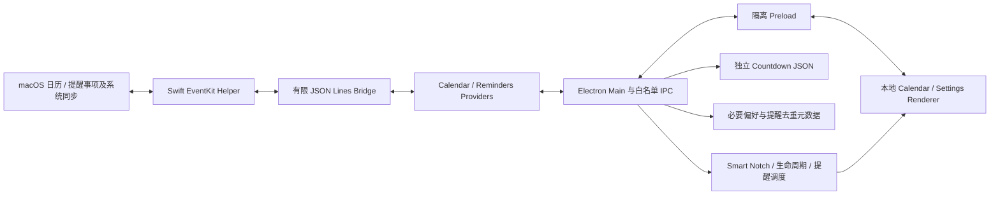

# Notchime — Phase 5B 最终代码审查、遗留清理与开源合规

审查日期：2026-10-11。当前维护者：**GAO TIANYU**（[GitHub](https://github.com/GAO9228TIANYU)，tianyu.gaospk@gmail.com）。本报告是实际源码、配置与隔离测试的审查记录，不是最终安装包、法律意见或跨系统认证。Phase 5A 报告保留原文，后续结论以本报告和本次证据为补充。

## 1. 审查范围与方法

检查根目录全部活动 JS、Main/Preload、全部 Renderer HTML/JS/CSS、Swift Helper 的两份源码及 Info.plist、build、scripts、tests/Fixture、package.json/锁文件、工作流、AGENTS/CLAUDE/README/CHANGELOG、.claude 开发配置、LICENSE，以及历史文档的运行/构建引用。依赖检查包括实际安装的包元数据和许可、锁文件及官方 npm 审计结果。大媒体、研究目录、.cache 仅清点路径/大小/数量，不读取真实日历、任务、私人截图或缓存内容作为审查证据。

逐文件 A–F 分类见 [文件清单](phase5b-file-inventory.md)。其中 A 是活动运行；B 构建/打包；C 活动测试；D 工程与归属文档；E 历史；F 内容或权利未完全确认。F 不是“确认无用”，因此未删除。node_modules、.cache、dist* 单独处理，不把它们全部当作源码或合法公开材料。

引用依据：Main 的 require/固定 Helper 路径、HTML script/link、Preload 白名单 IPC、注册 Handler/发送事件、npm scripts、Swift 编译输入、Builder 正向文件列表及 extraResources、测试 Fixture 动态注入。历史文档中的路径与命令不视为执行授权。

本阶段没有执行 Git、依赖安装/升级、原生签名脚本、正式打包/签名/公证/发布，没有修改应用身份或真实用户数据。图标替换是用户后续明确授权的资产例外；原图只读，转换结果写入项目。

## 2. 活动代码与信任边界

Calendar 没有事件写入接口。Reminders 唯一写入为当前有效、未完成、非重复、可写清单中的事项完成；Swift 仅赋值 isCompleted，EventKit 自行处理 completionDate。不创建任务副本数据库。系统同步属于 macOS/iCloud，不是 Notchime 自建网络。

活动旧业务清理已经在 Phase 2 完成。本次静态和隔离启动检查未发现 AI/转写/录音/摄像头/音乐/旧待办/剪贴板/HTTP 服务的可执行入口；不为使删除数量增加而删除通用窗口、计时上限、安全和状态管理代码。

## 3. 文件清理清单

### 已删除

| 文件 | 原因与证据 |
|---|---|
| build/to-do-panel-icon.icns | 用户指定新图后，Builder 已改用新 ICNS；没有其他活动引用。旧文件作为本地审查备份保留在 .cache/phase5b/legacy-icon.icns，不进入应用。 |

没有删除有效测试、LICENSE、上游署名、NOTICE、私人缓存或大型历史目录。没有删除 npm 包：当前无运行时 npm dependencies；开发依赖由有效构建链使用，不能因 Windows 子依赖名称而手工拆掉 Builder 图谱。

### 已修改

| 文件/范围 | 主要修改 |
|---|---|
| main.js | 用户可见品牌/Tray/About 统一 Notchime 与 GAO TIANYU；身份常量仍 Calendar Notch Dev；设置写入前验证已有文件，防止默认值覆盖损坏数据；纠正两处陈旧注释。 |
| renderer/index.html、renderer/app.js | title/aria/About/版本回退文案准确化；现有页面结构、两页导航、CSS 和交互保持。 |
| package.json | 当前维护者/描述/双方版权信息；显式运行文件和许可白名单；Electron/Chromium notices 资源；新图标引用。name/version/appId/productName/extendInfo/userData 身份不变。 |
| build/afterPack.js | 仅纠正注释中系统验证与功能描述；签名逻辑未修改或执行。 |
| scripts/release-policy.js | 删除不会被当前工作流消费的自动发布状态：始终 publish=false，仍严格拒绝版本不匹配标签。 |
| scripts/smoke-app.js | 断言当前可见品牌 Notchime，启动/隔离/安全断言保留。 |
| tests/calendar-native-contract.test.js | 精确断言 Helper + 两份 Electron 许可资源，没有放宽路径或结构断言。 |
| tests/release-policy.test.js | 匹配版本的标签也不授权发布；不匹配标签失败断言保留。 |
| tests/renderer-structure.test.js | 两项名称更新为当前 Calendar/Reminders 行为；原断言保留。 |
| tests/security.electron.js | 增加可见品牌与原身份分离、维护者/About 归属、四类损坏设置拒绝写入且保留字节；原安全断言全部保留。 |
| tests/automatic.electron.js | 增加失败时的有限取消来源诊断，仅 Fixture 测试使用，不改时序/断言/自动展开实现。 |
| README.md、AGENTS.md、CLAUDE.md、CHANGELOG.md | 最小工程说明、实际架构/权限/测试/阶段限制、维护者与来源；不是 Phase 5C 精美 README。 |
| .claude/settings.json、settings.local.json.example | 移除自动 hooks 和 Git/自动提交等允许项；保留禁止 Git/签名/打包等约束。 |
| .claude/rules/api-rules.md、skills/prd/SKILL.md、skills/qa-checklist/SKILL.md | 改为当前受控 IPC 与实际 JS/Swift 测试说明；技能仅用户手动选择，不自动下载 npx 工具或放宽测试。 |
| HARNESS-GUIDE.md、docs 下非 phase 历史 Markdown | 仅添加历史资料边界声明，保留原记录；不再作为当前需求/兼容性/发布指导。逐文件列于清单。 |
| .gitignore | 清除已不存在的网站条目，排除 promo 私人采集、输出和工具文件；没有执行 Git。 |

### 新增

NOTICE、THIRD_PARTY_NOTICES.md；build/notchime-icon.png / notchime-icon.icns；scripts/prepare-app-icon.js；tests/final-review.test.js；本报告及 phase5b-file-inventory.md。

图标 PNG 是用户文件的字节副本；脚本只从项目固定 PNG 生成多尺寸 ICNS，不接受任意输入路径，不签名或打包。ICNS 结构和十个尺寸项、iconutil 解码及解码图目视检查通过。保留原图黑底，不擅自移除背景。Finder/正式安装后的显示不在本轮验证范围。

### 已保留及无法完全确认

- LICENSE 保持上游逐字原文；Phase 1–5A 报告保留为历史证据，没有把旧成功结果改写成本轮结果。
- main-services.js 的通用计时上限；窗口焦点、Hover+Space、多屏、恢复、单实例与监听清理；它们有活动调用/测试，不属于旧产品功能。
- 原始窗口动画、Swift/Preload/安全 Provider/Countdown/调度器完整保留。
- docs/assets、docs/screenshots、历史设计/学习资料、promo 研究素材及工具保留。没有完全证实每份媒体的再分发权或私人内容，不能自动删除或公开。
- .claude/hooks 两份历史脚本及只读 code-reviewer 资料保留；当前配置不再注册 hooks，本轮未运行它们，不进入应用。不以历史文件中的 Git 命令作为授权。
- .cache 中旧日志、截图、原生产物、测试证据保留，不自动清理。只有已知的测试临时目录按测试原有 finally 清理。

## 4. 确认问题、修复与证据

| 编号 | 程度 | 位置 | 证据/影响 | 处理及验证 |
|---|---|---|---|---|
| B01 | Medium / 数据可靠性 | main.js:458、468 | 原读取异常回退默认值，写入只拦超大文件；语法损坏/数组/null 文件会被新设置覆盖。 | 写入先验证现存文件大小、JSON 和对象类型；坏文件保持原字节、返回 save_failed。security Electron 场景新增四类输入及两项设置写入断言。 |
| B02 | Low / 归属与发布 | package.json build.files/extraResources | 原正向白名单没有显式随附原 MIT 与完整 Electron/Chromium notices。 | 加入 LICENSE/NOTICE/THIRD_PARTY_NOTICES 及精确运行时许可资源；单元/契约测试精确核对。最终二进制包含情况仍 Not Verified。 |
| B03 | Low / 工程自动化 | .claude/settings.json、release-policy.js | 旧辅助配置会注册 hooks/自动提交；旧策略对版本标签输出 publish=true，与手动验证工作流不符。 | 移除自动执行及 Git 允许项；publish 永远 false 且保留版本验证；测试保护。未执行历史 hooks 或 workflow。 |
| B04 | Low / 信息真实性 | README、AGENTS、About、历史 docs | 描述仍停留 Mock/no-auto/旧作者产品；可能引导错误执行。 | 当前说明依据代码重写，历史加声明；Notchime 当前维护者与上游归属分开，身份字段未迁移。 |
| B05 | Informational / 产品资源 | mac.icon | 旧业务图标仍是活动构建资源。 | 按用户明确指定换为新 PNG/ICNS；结构/解码检查通过；新图片独立再分发许可待确认。 |

没有因个人风格拆分大文件、重命名计时工具或重写状态机；没有发现足够证据支持更多高风险删除。设置修复属于本次确认的已有问题，不修改正常文件格式、未知字段或有效用户数据。

## 5. 安全与可靠性回归审查

main-services.js:5 的发送者验证仍要求同一 BrowserWindow、mainFrame 和精确 file URL；24 个活动 Handler 全量来源测试保留。Preload 未增加 API。BrowserWindow contextIsolation=true、nodeIntegration=false、sandbox=true；生产 DevTools 禁用。session 拒绝 HTTP(S)/WS(S)/FTP 和 Chromium 权限，导航/重定向/webview/window.open 拒绝；本地资源与 EventKit 不受影响。CSP script/connect/object/frame/base/form 限制保留，动态颜色仍依赖受限 inline style，不为形式严格破坏界面。

Calendar/Reminders 标题与清单名通过 textContent，颜色经校验，不作为 HTML 或任意 CSS 运行。Helper 仍使用固定路径、无 shell；请求 1MiB、响应行 16MiB、最多64待处理请求、超时/关闭/恢复和诊断脱敏均保留（calendar-bridge.js）。Swift main.swift:170–180 完成分支仍严格检查有效 ID、未完成、当前截止筛选、非重复与可写清单，仅保存完成状态。

Countdown 仍独立 schemaVersion 1、串行原子写入、坏文件不覆盖。系统事件/任务只在内存展示；本地偏好和无标题的提醒去重元数据是合理持久化，不是第二套日程/任务库。撤权清内存、Helper 重启、跨午夜/时区、重复实例、睡眠恢复去重/不补历史提醒保留原测试。

修改前后保护哈希核验：LICENSE、三份 CSS、Preload、两份 Swift、Helper plist、automatic-reveal.js、entitlements 一致；applyMode/beginNativeCollapse、窗口几何函数和 Renderer setMode/waitForPanelMotion 的函数体逐字相同。原动画与布局没有修改。

## 6. 网络与依赖供应链

活动运行代码没有新增网络模块/URL/上报/自动更新。About 中 GitHub/邮箱是文本，不自动打开；仅固定 x-apple.systempreferences 权限设置入口。开发 smoke 测试使用受控 localhost CDP（HTTP/WebSocket），不是产品 HTTP 服务，测试退出关闭进程。npm/Actions 下载和 npm audit 访问官方 registry 属开发/构建通信，不包含日程/任务正文。macOS/iCloud 同步可能联网，不能描述为整个生态完全离线。

本轮官方 npm audit：**0 Critical、0 High、8 Moderate**；审计进程返回1代表存在公告，不是数据库不可用。当前无运行时 npm dependencies；284 个安装包声明许可已清点。Moderate 来自 sprintf-js 无界 precision DoS，经 roarr/global-agent/@electron/get/Builder 传播，共8个节点，不是8项独立根因。真实应用 UI 没有把用户格式字符串送入该工具链；开发/下载/打包供应链风险仍保留。audit 推荐的 Builder26.5.0 是当前26.15.7的降级路径，不能直接 force 自动处理。

Electron44.0.0/Builder26.15.7及锁文件/Phase5A overrides 未更改。http-cache-semantics 原 Phase5A 关于 max-stale 的边界风险仍需最终工具链评估；不能因 audit 当前无该项就宣称绝对安全。没有添加依赖或权限，没有升级 Electron 主版本，没有执行 npm audit fix。

## 7. 开源许可证与知识产权结论

### 上游源码：Verified

本地 LICENSE 与 [上游 v1.2.0 LICENSE](https://github.com/xiaopu-ai/TO-DO-Panel/blob/v1.2.0/LICENSE) 字节一致，双方 SHA-256：`7ab44bafe3a01fcb339a41791facd9125e27113b2715ceada87ddaa81ebd0c47`。上游声明 `Copyright (c) 2026 TO-DO Panel contributors`；不是根据“公开仓库”猜许可。

MIT 允许修改、使用、分发、再许可等，但副本/实质性部分必须保留原版权与许可文本及免责条款；不要求必须发布修改后的源码。项目来源不能描述为完全从零。此处依据 [MIT 原文](https://opensource.org/license/mit)；本轮没有替换或重新授权根 LICENSE。NOTICE 清楚区分现维护者与上游。未知历史资源和第三方代码不会自动受项目 MIT 重授权。

### 第三方与图标：Partially Verified / Not Verified

- Electron MIT 与 Chromium 第三方完整 notices 的实际本地文本存在，已明确配置随应用分发。Builder 为开发工具，不等于应用把全部工具链塞进去；如分发 node_modules/离线工具须逐包保留许可证。
- Renderer 使用系统字体引用，不随应用分发字体；活动图标 SVG/Tray 绘制没有新增外部图库。
- 用户新图标可在本地按指示使用；其原作者、来源和公开再分发许可 **Not Verified**。需要维护者确认后才能公开发布图标/源仓库/安装包；不能把“用户指定使用”等同公共再授权。
- promo 内 Noto OFL、imageio-ffmpeg BSD 声明存在，但并未证明所有截图、音乐、字体、FFmpeg 二进制/编译配置或素材都有统一 MIT 权利。该目录完全不进入应用；若用于后续宣传/源码发布，须另行逐资源审核。
- 最终 DMG 应包含 LICENSE/NOTICE/THIRD_PARTY_NOTICES 和匹配所发 Electron 的完整许可，不以这次配置验证冒充已验证最终 DMG。

源码许可证没有发现阻止保留版权的修改/分发条款，但图片与历史素材的权利仍是公开发布准入条件。

## 8. 品牌、维护者与文档准确性

用户可见页面标题、aria、Tray tooltip、设置 About、系统 About 以 Notchime 为产品；当前开发与维护 GAO TIANYU；联系方式为本报告页首。English slogan：There When You Need It. Quiet When You Don't. 中文：需要时出现，无需时静默。

开发身份刻意保留：package name=calendar-notch-dev、version=1.2.0、appId=com.calendarnotch.dev、productName/CFBundleDisplayName/app.setName=Calendar Notch Dev、Helper com.calendarnotch.dev.calendar-helper、独立 userData、安装产物名。系统权限/登录项/原生程序名可能仍显示开发身份；这是 Phase5D 待统一事项，不是遗漏的产品界面文案。本轮不得改成1.0或迁移 TCC/数据。

当前 README/AGENTS 不再声称仅 Mock、无自动展示、支持Windows/Linux或已完成正式签名公证。不宣称macOS13/14都真机验证；13.0是编译目标。Calendar Full Access 才能读取，行为限制只读；Reminders Full Access 由应用进一步限为完成，系统没有“仅完成权限”。历史 README/设计与阶段证据保留但明确非当前规范。Phase5C 再制作正式双语介绍/截图，不能使用未经脱敏或许可确认的历史截图。

## 9. 发布资源白名单

正向文件为 Main、通用服务、Preload、Calendar/Reminders Bridge/Providers/IPCs、Countdown store/IPC、自动展开和日程调度、设置、12个明确 Renderer 文件、package.json 及三份法律文本。无 renderer 通配吞入未知资源。Builder 本身仍有默认处理逻辑，配置审查不代替解包检查。

extraResources 仅固定 `.cache/native/CalendarNotchCalendarHelper.app`、实际 Electron LICENSE 与 LICENSES.chromium.html。本地固定 Helper 中目前只有 Info.plist、MacOS/calendar-helper、_CodeSignature/CodeResources；不是复制整个 .cache。icons 由 mac.icon 固定指向新 ICNS；PNG 来源不作为应用文件。

显式排除 .cache、.claude、docs、promo、tests、scripts、AGENTS、CLAUDE、HARNESS、.env、版本控制元文件和不必要 node_modules 文档测试。原生 Helper 的固定复制属于上述 cache 排除的明确例外。私人历史图片、研究录屏、测试 Fixture、源码辅助配置、旧图标不进入 app resources。后续源码公开范围与二进制白名单是不同问题，必须另外审核 F 类材料。

工作流只 workflow_dispatch、contents:read、严格 codesign/hdiutil 校验，未运行。本轮不修改 asar:false、fuses、entitlements、安全签名机制。正式包验证继续 Phase5E。

## 10. 实际测试与运行时证据

最终完整 `npm test` 返回 **0**，结果如下；没有删除、跳过或降低原有有效测试的断言。

| 检查 | 通过 | 失败 | 跳过 | 证据 |
|---|---:|---:|---:|---|
| Node 单元 | 140 | 0 | 0 | npm-test-verification.log；原135项 + 新5项 |
| 活动 JavaScript 语法 | 66 | 0 | 0 | 全部根模块/Renderer/scripts/tests/build；原64 + 新图标脚本/审查测试 |
| Electron GUI 场景 | 13 | 0 | 0 | 真实Electron/Main/Preload/Renderer，隔离Fixture |
| 源码启动 smoke | 1 | 0 | 0 | npm --ignore-scripts start，跳过的是签名预启动脚本，不是测试或断言 |
| Swift 类型检查 | 1 | 0 | 0 | swift-typecheck-final.log，arm64 / macOS13.0编译目标，未运行签名 |
| 新图标转换/结构/解码 | 1组 | 0 | 0 | ICNS十种尺寸项、长度边界、iconutil解码和目视检查 |
| npm依赖审计 | 公告数据库可用 | 8 Moderate | 不适用 | npm-audit.json；0Critical/0High，不描述为无漏洞 |

13个GUI场景具体为 appearance、notch-focus、startup初次/重启、Countdown CRUD/重启/损坏、Calendar初次/重启、automatic初次/重启、Reminders与security。覆盖日期/时间选择器、今日/未来7天、完成失败恢复/重复ID与重复任务保护、授权隔离/Helper恢复、Countdown持久化、Settings、Escape/blur/快速开合、模拟所有显示器监听、悬停接管与自动收起、24项IPC/恶意标题/非法导航/网络限制。启动自动收起实际记录约4399ms，包含退场动画；不是把动画时间改成4秒。

安全场景故意调用 unknown:channel 时Electron打印“No handler registered”，这是预期拒绝，不是应用未处理回归。Swift仅有SDK legacy-driver弃用提示，不是编译错误。本地证据统一在 `.cache/phase5b/`，不含真实日程或任务内容。

本机环境 macOS27.0、Apple Silicon、Node22.22、Electron44。Swift使用arm64-apple-macosx13.0目标进行类型检查，不签名/构建 Helper。macOS13/14真实授权链、iPhone同步、物理合盖/锁屏本次没有重新验收；前阶段用户验收不冒充本轮测试。

过程失败记录保留：首次单元有1项资源契约因新增两份必要许可证需要精确更新，已修复契约；第一轮GUI键盘焦点断言失败；第二轮启动自动收起等待失败。没有删除/跳过/放宽这些断言，没有修改核心状态机；增加取消诊断并独立重测自动场景通过。最后一轮完整回归与独立 automatic 场景都通过。两次早期GUI失败的根因未得到确定证据，不能断言只是环境问题，也不能以最后通过抹掉它们；桌面焦点/事件时序的稳定性需后续重复验收，当前没有据此改动已验收核心逻辑。

## 11. 剩余风险与下一阶段准入

- 新图标公开再分发权需维护者确认；历史宣传素材、私人录屏、工具二进制与研究目录不可随意公开。
- 8 Moderate 工具链供应链公告与原有 cache-semantics 边界需发布环境复核；当前无确认产品UI可达Critical/High，不等于工具链或全部输入绝对安全。
- 身份统一会影响TCC授权、登录项、userData与历史选择/Countdown，Phase5D须单独制定迁移/备份验证，不在本轮修改。
- 正式签名/deep strict既有失败、Finder metadata、Developer ID、公证、fuses、ASAR完整性、代码加载entitlements、最终DMG许可/资源/图标均未验收；不绕过校验，不本轮扩大修复。
- macOS13/14兼容性、真实多显示器/Spaces/全屏、物理恢复和真实iCloud仍需最终目标系统人工回归。
- UI快速开合/鼠标/焦点测试需要桌面环境稳定；失败结果不可用重跑成功抹去，完整记录见第10节。

Phase5C可以开展正式README准备，但仅使用合规/脱敏素材，并保留许可证和以上验证边界。Phase5D可开始独立身份方案与授权后的实现准备；本轮不批准迁移或公开发布。正式打包/发布准入仍受素材权利、稳定回归、供应链评估及Phase5E签名/fuses/ASAR/最终包验证限制，不能宣称已经达到发布验收。
